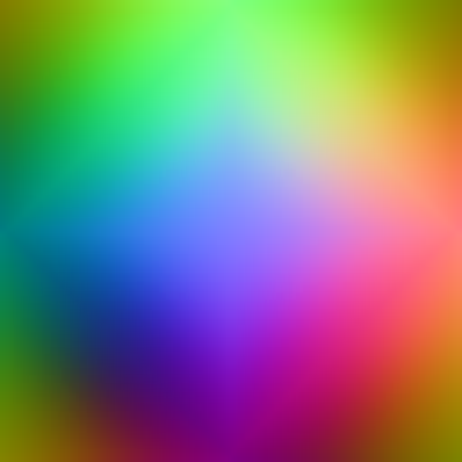
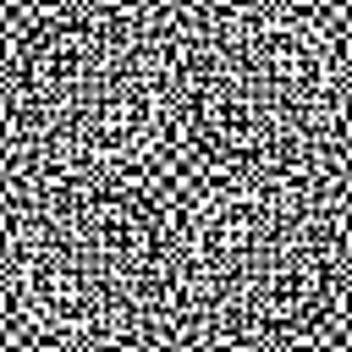
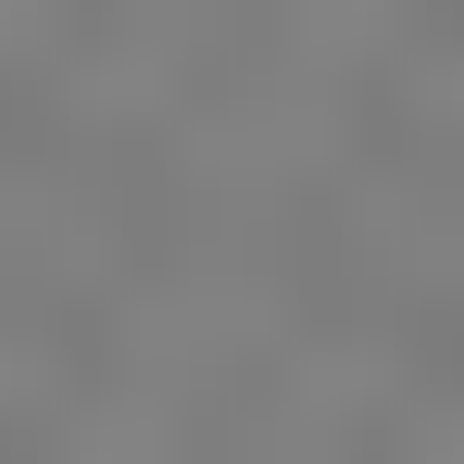

# Validation recorded on 2026-10-20

Reference: Graphics commit `a7e4c051d256a781ab362c64316b125a1e104694`, HDRP package 17.6.0. Implementation is the experimental sample on branch `codex/shared-oct-probe-prototype`.

## Passed: C# compilation

`Test-Compile.ps1` compiled the runtime atlas, example component and Editor test suite against the installed Tuanjie 2022.3.62t15 managed assemblies. Result: **0 warnings, 0 errors**. This checks C# API/type compatibility; it does not execute Unity native methods or establish that HDRP 17.6 runs in that Editor.

## Passed: native GPU validation

`Run-NativeGpuTests.ps1` compiled and executed the sample's original `.compute` and sampling `.hlsl` on **NVIDIA GeForce RTX 5060 Laptop GPU**, using a hardware D3D11 device and RGBAHalf textures. All **10 checks passed**. The compiler was the Windows SDK's D3D compiler; the harness was built with MSVC 14.51.

| Check | Observed metric |
|---|---:|
| Four compute entry points compile | Pass |
| Shared capture cube does not overwrite a previously published tile | Maximum color error 0 |
| Constant HDR radiance across all five tested GGX mips | Maximum RGB-channel error 0.00195312 |
| Cube-to-Oct direction field, including padding, against analytic directions | Maximum error 0.00147307 |
| Six single faces against the complete Cubemap path | Maximum error 0.00292969 |
| Oct-input GGX against Cubemap-input GGX across roughness mips | Maximum error 0.00146484 |
| Fractional LOD / seams with a contrasting adjacent probe | Maximum error 0.000146508 |
| Fractional LOD against separately sampled integer levels | Maximum error 9.31e-10 |
| High-frequency variance after GGX filtering | Rough/smooth variance ratio 0.000543684 |
| Partial face update preserves the other face regions | Maximum error 0 |

Unless otherwise noted, errors are maximum absolute RGB-channel errors in linear radiance. These are analytic test fixtures at source face size 64, Oct tile size 64, 256 GGX samples, and output mips 0 through 4. They are not a measured error bound for arbitrary HDR scenes or a comparison against stock HDRP's filtering implementation. Numerical fixtures and thresholds are in `NativeGpuTests.cpp`.

[Machine-readable results](native-results.json).

Cubemap path and single-face path, respectively (the previews are enlarged from 64x64):

High-frequency input and roughness mip 3:

## Not executed: Editor integration suite

The installed Tuanjie Editor batch launch exited before project import/compilation because its licensing client reported **No valid Unity Editor license found**. The runner was not launched with `-nographics`. No license settings were modified.

The 15 prepared Editor tests therefore have **no runtime pass result**. They include actual Camera.RenderToCubemap versus six Camera.Render views (with asymmetric wall patches), workspace ownership, publication/cancellation/version behavior, slot reuse, failure cleanup and disposal.

The independent D3D11 run does not validate Unity camera orientation, C# runtime lifecycle, RenderGraph scheduling, or integration into HDRP's built-in probe light loop.

## Not measured

- Full HDRP 17.6 project compilation / rendering, requiring a matching Editor.
- Frame-time or VRAM savings in an application scene.
- Charlie/fabric filtering, all graphics backends, exposure/sky parity, or production-quality high-contrast HDR seams.

The sample README documents these boundaries and the integration points that remain.
